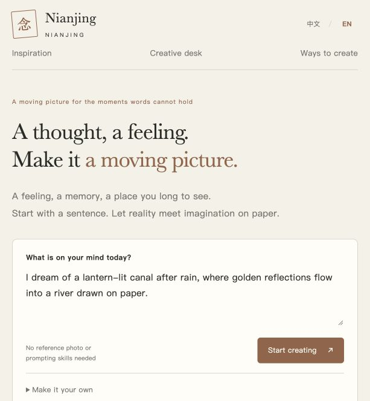

# 双语交付核验 / Bilingual verification v1.0

版本 / Version: 0.2.0。日期 / Date: 2026-10-09。

本地双语创作桌、文档及发布包准备完成。GitHub远程仓库、推送、Release与公开部署尚未执行。

The bilingual creative desk and release materials are prepared locally. No remote repository, push, GitHub Release or public deployment has been completed.

## 自动检查 / Automated checks

```sh
node --test 验证/流程验证v1.1.mjs
node 验证/交付检查v1.0.mjs
```

流程验证13项全部通过。交付检查覆盖52个文件与54个本地文档链接，错误为0。流程验证覆盖原有创作、错误处理、服务适配器、素材完整性、真实FFmpeg替换配乐及HTTP导入导出，并增加双语字典与页面标记、英文场景及修改、语言切换的数据保留、双语HTTP输出和旧构想兼容性。

All 13 workflow tests passed. The delivery check found no errors across 52 files and 54 local documentation links. Workflow tests cover creation, failures, adapter contracts, sample integrity, actual FFmpeg music replacement and HTTP import/export. Bilingual coverage includes dictionary and page markers, English scene matching and revisions, preservation of custom preferences, localized HTTP responses and compatibility with first-release plans.

真实FFmpeg检查比较换配乐前后的视频流哈希。付费生成测试未执行；远程GitHub Actions未执行。这里只报告本地检查。

The FFmpeg check compares video-stream hashes before and after music replacement. Paid generation and remote GitHub Actions have not run. These are local checks.

## 实际界面检查 / Live browser checks

在本机浏览器中完成以下检查：

- 中文与EN切换，标题、导航、表单、状态、服务说明、三类指令及示例文案随语言改变。
- 切换前后的想法文字、已有视频地址和已选视频文件值一致；切换未提交生成请求。
- 英文课堂想法创建本地等待导入任务；用英文修改钢琴配乐后，音乐指令随之更新，原媒体未被宣称已改变。
- 保存英文构想，实际下载的Markdown包含英文标题、原话、画面、动态和音乐三段指令以及最新修改。
- 语言选择同步到URL；页面重新加载可以恢复已保存任务及英文显示。
- 检查期间浏览器没有记录应用控制台错误。

In the local browser, Chinese / EN switching updates application text and all three prompt types. Original words, the current video URL and the selected video-file value remain unchanged. An English classroom idea creates an awaiting-import task; an English piano revision updates its prompt. The downloaded Markdown contains its English title, original idea, three prompt sections and latest revision. Language choice is reflected in the URL, and a reload restores the saved task and English display. No application console errors were recorded during these checks.

文件选择器、视频播放器原生控件等系统文字跟随操作系统或浏览器语言。用户原话及自定义偏好保持原文；本版没有调用机器翻译服务。

Native file pickers and video controls follow the operating system or browser language. User-authored words and custom preferences remain in their original language; no machine-translation service is called.

## 实际截图 / Actual screenshots

截图使用本次浏览器的实际窄窗口，未调整视口来制造展示效果。两张均可看到语言切换、主文案及创作输入区。

Captured in the browser's actual narrow viewport, without resizing it for presentation. Both show the language selector, main copy and idea form.




## 发布边界 / Release boundaries

默认使用可编辑规则模板。四段短片来自已有Muse创作。官方API适配器的离线验证不证明付费生成质量；示例媒体与音乐不包含在代码MIT授权中。私有配置和本地作品不进入Git提交或项目ZIP。

The director uses editable rules. The four films are existing Muse works. Offline adapter checks do not establish paid generation quality. Sample media and music are excluded from the MIT source-code grant. Private configuration and local creations are excluded from Git and the project ZIP.

[English README](../README.md) · [中文说明](中文说明v1.1.md) · [双语发布准备](GitHub发布准备v1.1.md)
